  <picture>
    <source media="(max-width: 760px) and (prefers-color-scheme: dark)" srcset="./assets/portrait-mobile-dark.svg">
    <source media="(max-width: 760px)" srcset="./assets/portrait-mobile-light.svg">
    <source media="(prefers-color-scheme: dark)" srcset="./assets/portrait-dark.svg">
    <source media="(prefers-color-scheme: light)" srcset="./assets/portrait-light.svg">
    
  </picture>

# 👋 Hi, I'm Shivam S. Pimple

### Full-Stack Web Developer (MERN) | Software Engineering Student

I build **scalable full-stack web applications** using modern technologies with a strong focus on:

- Clean architecture
- Modular code
- Real-world problem solving
- Production-ready systems

---

## 🌐 Socials

<table border="0">
  <tr>
    <td align="center">
       
      <b>LinkedIn</b>
    </td>
    <td align="center">
       
      <b>Email</b>
    </td>
    <td align="center">
      <a href="https://github.com/shivampimple29">
        <picture>
          <source media="(prefers-color-scheme: dark)" srcset="https://cdn.simpleicons.org/github/white">
          <source media="(prefers-color-scheme: light)" srcset="https://cdn.simpleicons.org/github/181717">
          
        </picture>
      </a> 
      <b>GitHub</b>
    </td>
  </tr>
</table>

---

## 🚀 About Me

- 🎓 B.Tech Information Technology (2024–2028)
- 💻 Full-Stack Web Developer (MERN)
- 🌱 Actively building real-world projects
- 🛠️ Focused on backend APIs, frontend architecture & databases
- 🎯 Goal: Production-ready Software Developer

---

## 🛠️ Tech Stack

### 🎨 Frontend

<table border="0">
  <tr>
    <td align="center">
       
      React
    </td>
    <td align="center">
       
      Redux
    </td>
    <td align="center">
       
      HTML5
    </td>
    <td align="center">
       
      CSS3
    </td>
  </tr>
  <tr>
    <td align="center">
       
      JavaScript
    </td>
    <td align="center">
       
      Bootstrap
    </td>
    <td align="center">
       
      Tailwind
    </td>
  </tr>
</table>

### ⚙️ Backend

<table border="0">
  <tr>
    <td align="center">
       
      Node.js
    </td>
    <td align="center">
       
      Express
    </td>
    <td align="center">
       
      REST
    </td>
    <td align="center">
       
      EJS
    </td>
  </tr>
</table>

### 🗄️ Databases

<table border="0">
  <tr>
    <td align="center">
       
      MongoDB
    </td>
    <td align="center">
       
      MySQL
    </td>
  </tr>
</table>

### 🧠 DSA

<table border="0">
  <tr>
    <td align="center">
       
      C
    </td>
    <td align="center">
       
      Java
    </td>
  </tr>
</table>

### 🧩 OOP

<table border="0">
  <tr>
    <td align="center">
       
      C++
    </td>
    <td align="center">
       
      Java
    </td>
    <td align="center">
       
      Python
    </td>
  </tr>
</table>

### 🧰 Tools & Platforms

<table border="0">
  <tr>
    <td align="center">
       
      Git
    </td>
    <td align="center">
       
      GitHub
    </td>
    <td align="center">
       
      VS Code
    </td>
  </tr>
  <tr>
    <td align="center">
       
      Postman
    </td>
    <td align="center">
       
      Hoppscotch
    </td>
  </tr>
</table>

---

  <picture>
    <source media="(prefers-color-scheme: dark)" srcset="https://github-readme-stats-shivam29s-projects.vercel.app/api?username=shivampimple29&show_icons=true&bg_color=0d1117&border_color=30363d&title_color=58a6ff&text_color=c9d1d9&icon_color=3fb950&border_radius=8&cache_seconds=86400">
    <source media="(prefers-color-scheme: light)" srcset="https://github-readme-stats-shivam29s-projects.vercel.app/api?username=shivampimple29&show_icons=true&bg_color=ffffff&border_color=d0d7de&title_color=0969da&text_color=1f2328&icon_color=1a7f37&border_radius=8&cache_seconds=86400">
    
  </picture>
  <picture>
    <source media="(prefers-color-scheme: dark)" srcset="https://github-readme-stats-shivam29s-projects.vercel.app/api/top-langs/?username=shivampimple29&layout=compact&card_width=467&langs_count=6&bg_color=0d1117&border_color=30363d&title_color=58a6ff&text_color=c9d1d9&border_radius=8&hide_border=false&cache_seconds=86400">
    <source media="(prefers-color-scheme: light)" srcset="https://github-readme-stats-shivam29s-projects.vercel.app/api/top-langs/?username=shivampimple29&layout=compact&card_width=467&langs_count=6&bg_color=ffffff&border_color=d0d7de&title_color=0969da&text_color=1f2328&border_radius=8&hide_border=false&cache_seconds=86400">
    
  </picture>

  <picture>
    <source media="(prefers-color-scheme: dark)" srcset="https://raw.githubusercontent.com/shivampimple29/shivampimple29/output/github-contribution-grid-snake-dark.svg">
    <source media="(prefers-color-scheme: light)" srcset="https://raw.githubusercontent.com/shivampimple29/shivampimple29/output/github-contribution-grid-snake.svg">
    
  </picture>

