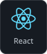
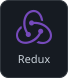
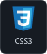
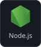
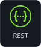
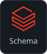
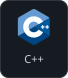
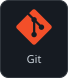
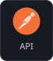

  <picture>
    <source media="(max-width: 760px) and (prefers-color-scheme: dark)" srcset="./assets/portrait-mobile-dark.svg">
    <source media="(max-width: 760px)" srcset="./assets/portrait-mobile-light.svg">
    <source media="(prefers-color-scheme: dark)" srcset="./assets/portrait-dark.svg">
    <source media="(prefers-color-scheme: light)" srcset="./assets/portrait-light.svg">
    
  </picture>

  <picture>
    <source media="(max-width: 760px) and (prefers-color-scheme: dark)" srcset="./assets/hero-mobile-dark.svg">
    <source media="(max-width: 760px)" srcset="./assets/hero-mobile-light.svg">
    <source media="(prefers-color-scheme: dark)" srcset="./assets/hero-dark.svg">
    <source media="(prefers-color-scheme: light)" srcset="./assets/hero-light.svg">
    
  </picture>

---

## 🌐 Socials

  <a href="https://www.linkedin.com/in/shivampimple">
    <picture>
      <source media="(prefers-color-scheme: dark)" srcset="./assets/social/linkedin-dark.svg">
      <source media="(prefers-color-scheme: light)" srcset="./assets/social/linkedin-light.svg">
      
    </picture>
  </a>
  <a href="mailto:shivampimple29@gmail.com">
    <picture>
      <source media="(prefers-color-scheme: dark)" srcset="./assets/social/email-dark.svg">
      <source media="(prefers-color-scheme: light)" srcset="./assets/social/email-light.svg">
      
    </picture>
  </a>
  <a href="https://github.com/shivampimple29">
    <picture>
      <source media="(prefers-color-scheme: dark)" srcset="./assets/social/github-dark.svg">
      <source media="(prefers-color-scheme: light)" srcset="./assets/social/github-light.svg">
      
    </picture>
  </a>

---

## 🛠️ Tech Stack

### 🎨 Frontend

  <picture>
    <source media="(prefers-color-scheme: dark)" srcset="./assets/tech/react-dark.svg">
    <source media="(prefers-color-scheme: light)" srcset="./assets/tech/react-light.svg">
    
  </picture>
  <picture>
    <source media="(prefers-color-scheme: dark)" srcset="./assets/tech/redux-dark.svg">
    <source media="(prefers-color-scheme: light)" srcset="./assets/tech/redux-light.svg">
    
  </picture>
  <picture>
    <source media="(prefers-color-scheme: dark)" srcset="./assets/tech/html5-dark.svg">
    <source media="(prefers-color-scheme: light)" srcset="./assets/tech/html5-light.svg">
    
  </picture>
  <picture>
    <source media="(prefers-color-scheme: dark)" srcset="./assets/tech/css3-dark.svg">
    <source media="(prefers-color-scheme: light)" srcset="./assets/tech/css3-light.svg">
    
  </picture>
  <picture>
    <source media="(prefers-color-scheme: dark)" srcset="./assets/tech/javascript-dark.svg">
    <source media="(prefers-color-scheme: light)" srcset="./assets/tech/javascript-light.svg">
    
  </picture>
  <picture>
    <source media="(prefers-color-scheme: dark)" srcset="./assets/tech/bootstrap-dark.svg">
    <source media="(prefers-color-scheme: light)" srcset="./assets/tech/bootstrap-light.svg">
    
  </picture>
  <picture>
    <source media="(prefers-color-scheme: dark)" srcset="./assets/tech/tailwindcss-dark.svg">
    <source media="(prefers-color-scheme: light)" srcset="./assets/tech/tailwindcss-light.svg">
    
  </picture>
  <picture>
    <source media="(prefers-color-scheme: dark)" srcset="./assets/tech/ejs-dark.svg">
    <source media="(prefers-color-scheme: light)" srcset="./assets/tech/ejs-light.svg">
    
  </picture>

### ⚙️ Backend

  <picture>
    <source media="(prefers-color-scheme: dark)" srcset="./assets/tech/nodejs-dark.svg">
    <source media="(prefers-color-scheme: light)" srcset="./assets/tech/nodejs-light.svg">
    
  </picture>
  <picture>
    <source media="(prefers-color-scheme: dark)" srcset="./assets/tech/express-dark.svg">
    <source media="(prefers-color-scheme: light)" srcset="./assets/tech/express-light.svg">
    
  </picture>
  <picture>
    <source media="(prefers-color-scheme: dark)" srcset="./assets/tech/rest-dark.svg">
    <source media="(prefers-color-scheme: light)" srcset="./assets/tech/rest-light.svg">
    
  </picture>

### 🗄️ Databases

  <picture>
    <source media="(prefers-color-scheme: dark)" srcset="./assets/tech/mongodb-dark.svg">
    <source media="(prefers-color-scheme: light)" srcset="./assets/tech/mongodb-light.svg">
    
  </picture>
  <picture>
    <source media="(prefers-color-scheme: dark)" srcset="./assets/tech/mysql-dark.svg">
    <source media="(prefers-color-scheme: light)" srcset="./assets/tech/mysql-light.svg">
    
  </picture>
  <picture>
    <source media="(prefers-color-scheme: dark)" srcset="./assets/tech/schema-dark.svg">
    <source media="(prefers-color-scheme: light)" srcset="./assets/tech/schema-light.svg">
    
  </picture>
  <picture>
    <source media="(prefers-color-scheme: dark)" srcset="./assets/tech/crud-dark.svg">
    <source media="(prefers-color-scheme: light)" srcset="./assets/tech/crud-light.svg">
    
  </picture>

### 🧠 DSA

  <picture>
    <source media="(prefers-color-scheme: dark)" srcset="./assets/tech/c-dark.svg">
    <source media="(prefers-color-scheme: light)" srcset="./assets/tech/c-light.svg">
    
  </picture>
  <picture>
    <source media="(prefers-color-scheme: dark)" srcset="./assets/tech/java-dark.svg">
    <source media="(prefers-color-scheme: light)" srcset="./assets/tech/java-light.svg">
    
  </picture>

### 🧩 OOP

  <picture>
    <source media="(prefers-color-scheme: dark)" srcset="./assets/tech/c-dark.svg">
    <source media="(prefers-color-scheme: light)" srcset="./assets/tech/c-light.svg">
    
  </picture>
  <picture>
    <source media="(prefers-color-scheme: dark)" srcset="./assets/tech/cplusplus-dark.svg">
    <source media="(prefers-color-scheme: light)" srcset="./assets/tech/cplusplus-light.svg">
    
  </picture>
  <picture>
    <source media="(prefers-color-scheme: dark)" srcset="./assets/tech/java-dark.svg">
    <source media="(prefers-color-scheme: light)" srcset="./assets/tech/java-light.svg">
    
  </picture>
  <picture>
    <source media="(prefers-color-scheme: dark)" srcset="./assets/tech/python-dark.svg">
    <source media="(prefers-color-scheme: light)" srcset="./assets/tech/python-light.svg">
    
  </picture>

### 🧰 Tools & Platforms

  <picture>
    <source media="(prefers-color-scheme: dark)" srcset="./assets/tech/git-dark.svg">
    <source media="(prefers-color-scheme: light)" srcset="./assets/tech/git-light.svg">
    
  </picture>
  <picture>
    <source media="(prefers-color-scheme: dark)" srcset="./assets/tech/github-dark.svg">
    <source media="(prefers-color-scheme: light)" srcset="./assets/tech/github-light.svg">
    
  </picture>
  <picture>
    <source media="(prefers-color-scheme: dark)" srcset="./assets/tech/vscode-dark.svg">
    <source media="(prefers-color-scheme: light)" srcset="./assets/tech/vscode-light.svg">
    
  </picture>
  <picture>
    <source media="(prefers-color-scheme: dark)" srcset="./assets/tech/api-dark.svg">
    <source media="(prefers-color-scheme: light)" srcset="./assets/tech/api-light.svg">
    
  </picture>
  <picture>
    <source media="(prefers-color-scheme: dark)" srcset="./assets/tech/hoppscotch-dark.svg">
    <source media="(prefers-color-scheme: light)" srcset="./assets/tech/hoppscotch-light.svg">
    
  </picture>

---

  <picture>
    <source media="(prefers-color-scheme: dark)" srcset="https://github-readme-stats-shivam29s-projects.vercel.app/api?username=shivampimple29&show_icons=true&bg_color=0d1117&border_color=30363d&title_color=58a6ff&text_color=c9d1d9&icon_color=3fb950&border_radius=8&cache_seconds=86400">
    <source media="(prefers-color-scheme: light)" srcset="https://github-readme-stats-shivam29s-projects.vercel.app/api?username=shivampimple29&show_icons=true&bg_color=ffffff&border_color=d0d7de&title_color=0969da&text_color=1f2328&icon_color=1a7f37&border_radius=8&cache_seconds=86400">
    
  </picture>
  <picture>
    <source media="(prefers-color-scheme: dark)" srcset="https://github-readme-stats-shivam29s-projects.vercel.app/api/top-langs/?username=shivampimple29&layout=compact&card_width=467&langs_count=6&bg_color=0d1117&border_color=30363d&title_color=58a6ff&text_color=c9d1d9&border_radius=8&hide_border=false&cache_seconds=86400">
    <source media="(prefers-color-scheme: light)" srcset="https://github-readme-stats-shivam29s-projects.vercel.app/api/top-langs/?username=shivampimple29&layout=compact&card_width=467&langs_count=6&bg_color=ffffff&border_color=d0d7de&title_color=0969da&text_color=1f2328&border_radius=8&hide_border=false&cache_seconds=86400">
    
  </picture>

  <picture>
    <source media="(prefers-color-scheme: dark)" srcset="https://raw.githubusercontent.com/shivampimple29/shivampimple29/output/github-contribution-grid-snake-dark.svg">
    <source media="(prefers-color-scheme: light)" srcset="https://raw.githubusercontent.com/shivampimple29/shivampimple29/output/github-contribution-grid-snake.svg">
    
  </picture>

